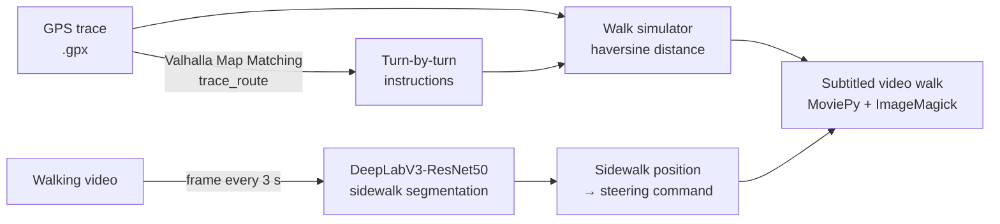

# Route Planning for the Visually Impaired (SENSATION)

**Master's seminar project, FAU Erlangen-Nürnberg (Winter 2023/24)** · Team: Anubhav Singh, Amit Jadhav, Zhipeng Peng

Part of the research initiative *Road Scene Understanding for the Visually Impaired*, which develops **SENSATION** (Sidewalk Environment Detection System for Assistive NavigaTION): a chest-mounted NVIDIA Jetson Nano with webcam, GPS and vibration motors that guides blind and visually impaired pedestrians (BVIPs). The real-world test route runs from Erlangen main station to the University Library.

Our group built the software that combines **GPS route planning** with **sidewalk segmentation** and turns them into spoken-style navigation commands.

## What we built



- **Route planning** (`myroutes/`, `main.py`, `request.py`): Valhalla Map Matching API (`route`, `trace_route`, `trace_attributes`) snaps GPS coordinates to the pedestrian network and returns narrative turn instructions. A walk simulator replays the GPS trace and fires each instruction when the walked distance reaches the next manoeuvre.
- **Sidewalk segmentation** (`train.py`, `training_pipeline.py`, `sensation/`): DeepLabV3 with a ResNet-50 backbone (ImageNet-pretrained, ASPP), trained on Cityscapes remapped to 8 classes, 256×256 input, Adam (lr 1e-4, weight decay 1e-5), **weighted cross-entropy** to handle the heavy class imbalance, 50 epochs, batch size 32.
- **Evaluation** (`inference.py`, `compute_IOU.py`): tested on Mapillary images, **IoU 0.55** on unseen data (validation loss 0.048).
- **Video walk demo** (`generate_video_walk.py`, `rsu_vi.py`): runs segmentation on the walking video every 3 seconds, derives a direction command from where the sidewalk is, and overlays both the route instructions and the sidewalk commands as subtitles.

**Stack:** Python · PyTorch · torchvision (DeepLabV3) · Valhalla API · GPX/geospatial processing · OpenCV · MoviePy · ONNX export

## Challenges and next steps

GPU access was the main constraint: we trained on online GPUs with reduced batch size, image size and epochs. Next steps we identified: other backbones (ResNet-101, MobileNetV3), training on Mapillary, longer training, and Dice / focal / Jaccard losses.

## Setup and usage

### Install
#### for linux:
1. sudo apt-get install imagemagick
2. pip install -r requirements.txt
3. sudo apt-get install libmagick++-dev
4. (1)sudo vim /etc/ImageMagick-6/policy.xml  and  comment the policy.xml by change from \<policy domain="path" rights="none" pattern="@*" /> to \<!--\<policy domain="path" rights="none" pattern="@*" /> -->  
    notice: there are two lines you need to comment.  
   or  
   (2)sudo mv policy.xml /etc/ImageMagick-6/policy.xml

#### for macOS:
1. brew install imagemagick
2. pip install -r requirements.txt


#### for windows:
1. install imagemagic. check <https://zulko.github.io/moviepy/install.html>
2. pip install -r requirements.txt

### Edited Video Link:
https://faubox.rrze.uni-erlangen.de/getlink/fi2XDxAas5pd8tdh3Dvo8V/edited_video.mp4

### link to trained weights:
https://faubox.rrze.uni-erlangen.de/getlink/fi8Gr2BJugqAZDfF8LPjvi/deeplab_model_final.pth

### link to test video:
https://faubox.rrze.uni-erlangen.de/getlink/fi66Ra3Se2zFQg73kbNc7v/testvdo.mp4

### To run the generate_video_walk file:
```
python3 generate_video_walk.py files/walking_video.mp4 edited_video.mp4

```

### to run train.py file:
```
python3 train.py /path/to/training/images /path/to/training/labels /path/to/validation/images /path/to/validation/labels

```
### to run training_pipeline.py file:
```
python3 training_pipeline.py /path/to/training/images /path/to/training/labels /path/to/validation/images /path/to/validation/labels /path/to/deeplab_model

```

### to run inference.py file:
```
python3 inference.py /path/to/test/mapillary/images /path/to/test/mapillary/ground/truth/labels /path/to/model/output /path/to/deeplab_model

```
### to run convert_masks_to_grayscale.py file:
```
python3 convert_masks_to_grayscale.py /path/to/config.json /path/to/training/labels /path/to/output/training/labels path/to/validation/labels /path/to/output/validation/labels /path/to/testing/labels /path/output/testing/labels

```

### to run rsu_vi.py file:
```
python3 rsu_vi.py /path/to/test/input/video.mp4 /path/to/testgps.gpx/file /path/to/output/video.mp4

```
